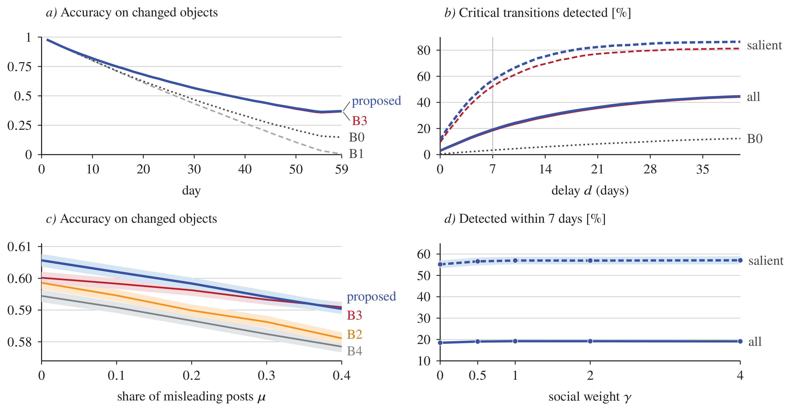

# Multi-Agent Verification of Damaged Infrastructure Digital Twins Using Multimodal Evidence

[](LICENSE)
[](requirements.txt)
[](data/README.md)

Code, results and figures for the paper *Multi-Agent Verification of Damaged Infrastructure Digital Twins Using
Multimodal Evidence* (S. Dolhopolov, V. Hots, Kyiv National University of Construction and Architecture).

Digital twins (DTs) of war-damaged buildings go out of date between inspections. This repository implements a
closed-loop **multi-agent verification** method that keeps the DT state current under a limited inspection budget:

- **Perception agent.** Turns citizen image–text posts into calibrated damage probabilities, reliability scores and sentiment (CLIP ViT-L/14, Grad-CAM, TimeLMs RoBERTa).
- **Verifier agents.** Fuse evidence by a *reliability-tempered* Bayesian update. They use *Bayesian surprise* to confirm, accept or quarantine an item and project beliefs onto engineering invariants.
- **Planner agent.** Allocates inspections by decision-theoretic *value of information*, weighted by social concern.
- **Tool-smith agent.** Admits generated verification modules only after *DT-oracle* property tests.

The DT state ages according to a continuous-time Markov chain calibrated on real **UNOSAT** multi-temporal damage
assessments of Mariupol (14 March → 7–12 May 2022).

<p align="center">
  
</p>

## Key results

Semi-synthetic, trace-driven replay anchored on the real UNOSAT labels: 8,649 objects, real CrisisMMD
image–text posts, 30 paired runs, 43 inspections per day. Means; the full table with ablations is in
[`results/replay/numbers.json`](results/replay/numbers.json).

| Policy | Accuracy, changed objects | Detected ≤ 7 d, all | Detected ≤ 7 d, salient | Delay, salient (days) | False alarms, posted objects |
|---|---:|---:|---:|---:|---:|
| B0 periodic inspections | 0.497 | 3.4 % | 4.0 % | 28.6 | 0.18 % |
| B1 value of information, no posts | 0.450 | 0.2 % | 0.3 % | 31.4 | 0.02 % |
| B2 naive Bayesian fusion | 0.590 | 18.2 % | 54.4 % | 8.5 | 0.36 % |
| B3 linear pooling (previous architecture) | 0.596 | 18.5 % | 52.4 % | 8.7 | 0.44 % |
| B4 confidence-tempered fusion | 0.587 | 18.0 % | 53.7 % | 8.5 | 0.43 % |
| **Proposed** | **0.598** | **19.2 %** | **57.0 %** | **7.9** | 0.42 % |

- **Main gain over the strongest baselines.** The proposed method detects changes on socially salient objects earlier: +4.6 percentage points within seven days and 0.87 days sooner than B3, +2.6 points than B2 (Wilcoxon p < 10⁻⁴). The overall accuracy gain over B3 is small (+0.21 points).
- **Evidence reliability.** Explanation features (Grad-CAM concentration, deletion faithfulness) did **not** improve the estimate beyond calibrated confidence: AUROC 0.783 with them vs 0.784 without ([`results/perception`](results/perception)).
- **DT-oracle tests.** Property tests detected 96.6 % of the non-equivalent single-point mutants of the verification modules without reference outputs, and 98.9 % together with example-based tests ([`results/mutation`](results/mutation)).

<p align="center">
  
</p>

## Repository structure

```
├── reproduce.py                 one-command reproduction of all steps
├── src/
│   ├── dtcore.py                verification modules: ageing, tempered update, surprise, invariants, VoI (Eqs. 1–10)
│   ├── sim_dt.py                trace-driven replay with all policies, ablations and sweeps
│   ├── perception_features.py   perception agent on CrisisMMD (GPU)
│   ├── reliability_eval.py      evidence-reliability models (Table 1)
│   ├── mutation_study.py        mutation analysis of the DT-oracle tests (Table 3)
│   ├── estimate_unosat_q.py     CTMC calibration on UNOSAT
│   ├── summarize.py             tables, paired tests, sensitivity, data for Fig. 3
│   ├── make_fig2_data.py        data for Fig. 2
│   ├── diagnostics.py           inspection targeting and the illustrative trace
│   ├── export_figures.py        compile TikZ figures and export SVG/PNG
│   └── download_data.py         UNOSAT and CrisisMMD downloads
├── data/
│   ├── README.md                sources and licences
│   └── processed/crisismmd_features.csv   perception outputs for the 3,526 CrisisMMD items (no tweet texts)
├── results/                     outputs of every step (calibration, perception, replay, mutation)
└── figures/                     TikZ/PGFPlots sources, plotted data, PDF/SVG/PNG
```

## Reproducing the results

```bash
python -m venv .venv && source .venv/bin/activate      # Windows: .venv\Scripts\activate
pip install -r requirements.txt
python reproduce.py --quick        # smoke test, ~5 min
python reproduce.py                # full run, ~25 min on one CPU core
```

- **Data.** `reproduce.py` downloads the open data automatically (see [`data/README.md`](data/README.md)).
- **Perception features.** A precomputed copy is included, so the full run needs no GPU. To recompute them, install `requirements-perception.txt` and add `--perception`. This downloads about 415 MB of images and runs CLIP ViT-L/14; we used an RTX 4080 SUPER.
- **Figures.** Compiling them needs a LaTeX distribution with TikZ/PGFPlots and newtx (MiKTeX or TeX Live). Without it the step is skipped, and the compiled figures are already in `figures/`.

| Paper element | Produced by | Output |
|---|---|---|
| Fig. 2a, CTMC fit | `estimate_unosat_q.py`, `make_fig2_data.py` | `results/calibration/`, `figures/data/` |
| Table 1 | `perception_features.py`, `reliability_eval.py` | `results/perception/` |
| Table 2, Fig. 2b–d, Fig. 3 | `sim_dt.py`, `summarize.py` | `results/replay/` |
| Table 3 | `mutation_study.py` | `results/mutation/` |

All hyper-parameters are tuned on a calibration half of the UNOSAT objects. All reported results come from the
disjoint evaluation half, and every policy, sweep and ablation uses the same 30 random seeds (common random numbers).

## Scope and limitations

- **The replay is semi-synthetic.** The March and May damage labels and the posts are real. The intermediate damage paths, posting rates, misattribution and inspection accuracy are modelled, and 68 % of the objects are undamaged structures imputed from the reported damage share.
- **No language model in the loop.** The agents are deterministic services around the numerical core. The tool-smith admission tests are evaluated by mutation analysis, not with a code generator in the loop.
- **Domain shift.** CrisisMMD posts come from natural disasters, not war damage.

## Citation

```bibtex
@unpublished{dolhopolov2026multiagent,
  title  = {Multi-Agent Verification of Damaged Infrastructure Digital Twins Using Multimodal Evidence},
  author = {Dolhopolov, Serhii and Hots, Vladyslav},
  note   = {Manuscript in preparation},
  year   = {2026}
}

@inproceedings{dolhopolov2026agentic,
  title     = {Agentic {AI}-Driven Architecture for Dynamic Verification of Infrastructure Digital Twins},
  author    = {Dolhopolov, Serhii and Honcharenko, Tetyana and Dudnyk, Yuriy and Hots, Vladyslav and Fesan, Anatolii and Batyr, Nursaya},
  booktitle = {2026 IEEE 6th International Conference on Smart Information Systems and Technologies (SIST)},
  pages     = {1--7},
  year      = {2026},
  doi       = {10.1109/SIST61674.2026.11596258}
}
```

## Acknowledgements

This work was carried out within the applied research projects “AI-Agent-Based System for Dynamic Verification
and Condition Monitoring of Digital Twins for Damaged Infrastructure Objects” (state registration number
0126U001450) and “Methodology for determining tonality and classification of multimodal content in territorial
revitalization projects based on neural network methods” (0125U001683).

The figure style follows Kapteyn, Pretorius & Willcox (2021, *Nature Computational Science*) and Torzoni et al.
(2024, *CMAME*).

## License

- **Code:** [MIT](LICENSE).
- **Figures and results:** [CC BY 4.0](https://creativecommons.org/licenses/by/4.0/).
- **`data/processed/crisismmd_features.csv`:** derived from CrisisMMD and therefore distributed under [CC BY-NC-SA 4.0](https://creativecommons.org/licenses/by-nc-sa/4.0/).
- **Third-party data:** UNOSAT and CrisisMMD are not redistributed here. See [`data/README.md`](data/README.md).
