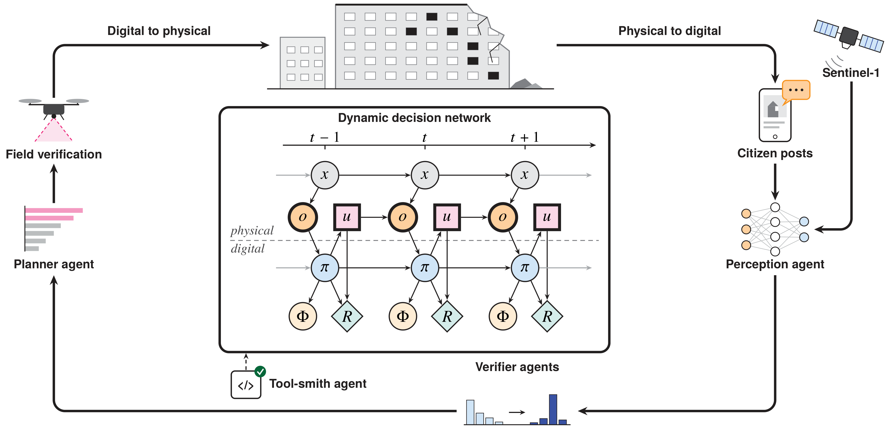

# Multi-Agent Verification of Damaged Infrastructure Digital Twins Using Multimodal Evidence

[](LICENSE)
[](requirements.txt)
[](data/README.md)

Code, results and figures for the paper *Multi-Agent Verification of Damaged Infrastructure Digital Twins Using
Multimodal Evidence* (S. Dolhopolov, V. Hots, Kyiv National University of Construction and Architecture).

Digital twins (DTs) of war-damaged buildings go out of date between inspections. This repository implements a
closed-loop **multi-agent verification** method that keeps the DT state current under a limited inspection budget.
It fuses two complementary evidence streams with targeted inspections: citizen image–text posts and Sentinel-1
radar change scores.

- **Perception agent.** Turns citizen posts into calibrated damage probabilities, reliability scores and sentiment (CLIP ViT-L/14, Grad-CAM, TimeLMs RoBERTa), and radar change scores into likelihoods.
- **Verifier agents.** Fuse the evidence by a Bayesian update *tempered by the reliability of each source*. They use *Bayesian surprise* to confirm, accept or quarantine an item and project beliefs onto engineering invariants.
- **Planner agent.** Allocates inspections by decision-theoretic *value of information*, weighted by social concern.
- **Tool-smith agent.** Admits generated verification modules only after *DT-oracle* property tests.

The DT state ages according to a continuous-time Markov chain calibrated on real **UNOSAT** multi-temporal damage
assessments of Mariupol (14 March → 7–12 May 2022).

<p align="center">
  
</p>

## Key results

The evaluation is a semi-synthetic, trace-driven replay anchored on the real UNOSAT labels:

- **Objects:** 8,649.
- **Citizen evidence:** real CrisisMMD image–text posts.
- **Radar evidence:** Sentinel-1 change scores *simulated* with the building-level accuracy reported for Ukraine — AUC 0.81 ([Dietrich et al., 2025](https://doi.org/10.1038/s43247-025-02183-7)) — at a 12-day revisit, with persistent object-specific errors.
- **Inspection budget:** 43 inspections per day.
- **Runs:** 30 paired runs.

All hyper-parameters are tuned on a disjoint calibration half by the Brier score. The full table with ablations is in
[`results/replay/numbers.json`](results/replay/numbers.json).

| Policy | AUROC (risk ranking) | Precision, % | Recall, % | F1 | Salient objects detected ≤ 21 d, % | Median delay, salient (d) | False alarms, % |
|---|---:|---:|---:|---:|---:|---:|---:|
| B0 periodic inspections | 0.632 | 91.2 | 13.5 | 0.236 | 10.2 | 27.7 | 0.07 |
| B1R radar screening, no posts | 0.826 | 89.4 | 46.3 | 0.610 | 40.3 | 17.8 | 0.30 |
| B2 naive Bayesian fusion | 0.859 | 84.0 | 59.9 | 0.699 | 86.9 | 6.5 | 0.57 |
| B3 linear pooling (previous architecture) | 0.845 | 96.9 | 56.2 | 0.711 | 87.5 | 6.4 | 0.09 |
| B4 confidence-tempered fusion | 0.857 | 96.5 | 59.2 | **0.733** | 87.8 | 6.3 | 0.10 |
| **Proposed** (posts + radar) | **0.860** | **97.4** | 58.0 | 0.727 | **89.1** | **6.0** | **0.08** |
| Proposed, posts only | 0.754 | 96.2 | 46.1 | 0.623 | 89.6 | 5.5 | 0.08 |

Precision, recall and F1 describe the twin's register of severely damaged and destroyed objects on day 59.

- **Two sources beat one.** Fusing posts and radar raises the AUROC to 0.86, against 0.75 for posts alone and 0.83 for radar alone.
- **Reliability tempering.** It keeps the precision at 97–98 % for any persistence of radar errors, whereas naive Bayesian fusion falls to 78 % ([`sim_sar_rho.csv`](results/replay/sim_sar_rho.csv)).
- **Better radar.** With coherence-grade radar (AUC 0.95 per acquisition) the proposed method reaches an AUROC of 0.92, an F1 of 0.85 and a precision of 98.7 % ([`sim_sar_auc.csv`](results/replay/sim_sar_auc.csv)).
- **Explanation features.** Grad-CAM concentration and deletion faithfulness did **not** improve the reliability estimate beyond calibrated confidence: AUROC 0.783 with them vs 0.784 without ([`results/perception`](results/perception)).
- **DT-oracle tests.** Property tests detected 96.6 % of the non-equivalent single-point mutants of the verification modules without reference outputs, and 98.9 % together with example-based tests ([`results/mutation`](results/mutation)).

<p align="center">
  
</p>

## Repository structure

```
├── reproduce.py                 one-command reproduction of all steps
├── src/
│   ├── dtcore.py                verification modules: ageing, tempered update, surprise, invariants, VoI (Eqs. 1–10)
│   ├── sim_dt.py                trace-driven replay with posts and radar: policies, ablations, sweeps (parallel)
│   ├── perception_features.py   perception agent on CrisisMMD (GPU)
│   ├── reliability_eval.py      evidence-reliability models (Table 1)
│   ├── mutation_study.py        mutation analysis of the DT-oracle tests (Table 3)
│   ├── estimate_unosat_q.py     CTMC calibration on UNOSAT
│   ├── summarize.py             tables, paired tests, sweeps, data for Fig. 3
│   ├── make_fig2_data.py        data for Fig. 2
│   ├── export_figures.py        compile TikZ figures and export SVG/PNG
│   └── download_data.py         UNOSAT and CrisisMMD downloads
├── data/
│   ├── README.md                sources and licences
│   └── processed/crisismmd_features.csv   perception outputs for the 3,526 CrisisMMD items (no tweet texts)
├── results/                     outputs of every step (calibration, perception, replay, mutation)
└── figures/                     TikZ/PGFPlots sources, plotted data, PDF/SVG/PNG
```

## Reproducing the results

```bash
python -m venv .venv && source .venv/bin/activate      # Windows: .venv\Scripts\activate
pip install -r requirements.txt
python reproduce.py --quick        # smoke test, a few minutes
python reproduce.py                # full run, about 10 min on a multi-core CPU
```

- **Data.** `reproduce.py` downloads the open data automatically (see [`data/README.md`](data/README.md)). The radar scores are simulated inside the replay, so no satellite data are downloaded.
- **Parallelism.** The replay uses up to 27 worker processes. Results do not depend on their number.
- **Perception features.** A precomputed copy is included, so the full run needs no GPU. To recompute them, install `requirements-perception.txt` and add `--perception`. This downloads about 415 MB of images and runs CLIP ViT-L/14; we used an RTX 4080 SUPER.
- **Figures.** Compiling them needs a LaTeX distribution with TikZ/PGFPlots and newtx (MiKTeX or TeX Live). Without it the step is skipped, and the compiled figures are already in `figures/`.

| Paper element | Produced by | Output |
|---|---|---|
| Fig. 2a, CTMC fit | `estimate_unosat_q.py`, `make_fig2_data.py` | `results/calibration/`, `figures/data/` |
| Table 1 | `perception_features.py`, `reliability_eval.py` | `results/perception/` |
| Table 2, Fig. 2b–e, Fig. 3, sensitivity analyses | `sim_dt.py`, `summarize.py` | `results/replay/` |
| Table 3 | `mutation_study.py` | `results/mutation/` |

Every policy, sweep and ablation uses the same 30 random seeds (common random numbers). For every radar setting in the
sensitivity analysis, the radar weights are re-selected on the calibration half.

## Scope and limitations

- **The replay is semi-synthetic.** The March and May damage labels and the citizen posts are real. The intermediate damage paths, posting rates, misattribution, inspection accuracy and the radar scores are modelled, and 68 % of the objects are undamaged structures imputed from the reported damage share.
- **The radar is a Gaussian score model** calibrated to the published building-level accuracy. It is not real Sentinel-1 data, and a validation on real Sentinel-1 time series is future work.
- **No language model in the loop.** The agents are deterministic services around the numerical core. The tool-smith admission tests are evaluated by mutation analysis, not with a code generator in the loop.
- **Domain shift.** CrisisMMD posts come from natural disasters, not war damage.

## Citation

```bibtex
@unpublished{dolhopolov2026multiagent,
  title  = {Multi-Agent Verification of Damaged Infrastructure Digital Twins Using Multimodal Evidence},
  author = {Dolhopolov, Serhii and Hots, Vladyslav},
  note   = {Manuscript in preparation},
  year   = {2026}
}

@inproceedings{dolhopolov2026agentic,
  title     = {Agentic {AI}-Driven Architecture for Dynamic Verification of Infrastructure Digital Twins},
  author    = {Dolhopolov, Serhii and Honcharenko, Tetyana and Dudnyk, Yuriy and Hots, Vladyslav and Fesan, Anatolii and Batyr, Nursaya},
  booktitle = {2026 IEEE 6th International Conference on Smart Information Systems and Technologies (SIST)},
  pages     = {1--7},
  year      = {2026},
  doi       = {10.1109/SIST61674.2026.11596258}
}
```

## Acknowledgements

This work was carried out within the applied research projects “AI-Agent-Based System for Dynamic Verification
and Condition Monitoring of Digital Twins for Damaged Infrastructure Objects” (state registration number
0126U001450) and “Methodology for determining tonality and classification of multimodal content in territorial
revitalization projects based on neural network methods” (0125U001683).

The figure style follows Kapteyn, Pretorius & Willcox (2021, *Nature Computational Science*) and Torzoni et al.
(2024, *CMAME*).

## License

- **Code:** [MIT](LICENSE).
- **Figures and results:** [CC BY 4.0](https://creativecommons.org/licenses/by/4.0/).
- **`data/processed/crisismmd_features.csv`:** derived from CrisisMMD and therefore distributed under [CC BY-NC-SA 4.0](https://creativecommons.org/licenses/by-nc-sa/4.0/).
- **Third-party data:** UNOSAT and CrisisMMD are not redistributed here. See [`data/README.md`](data/README.md).
